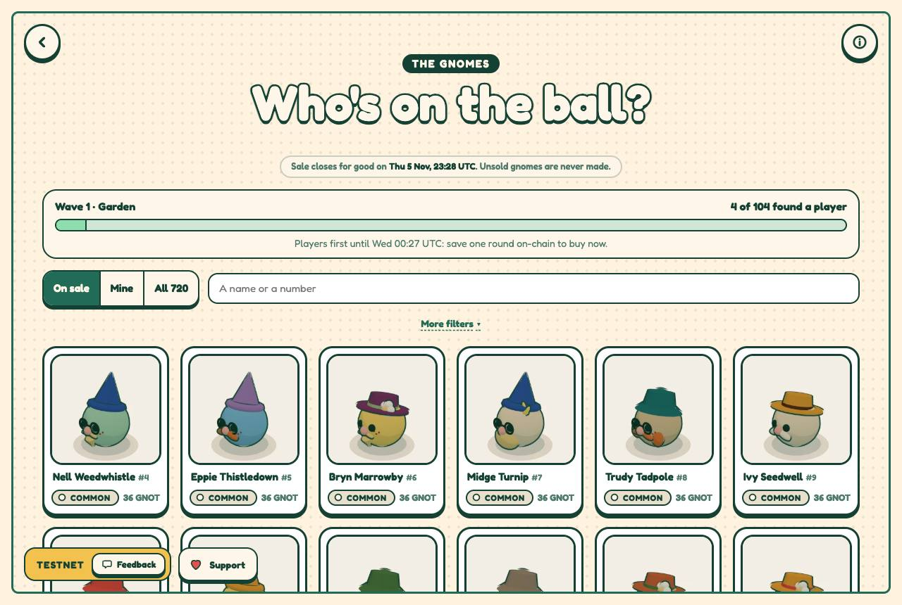
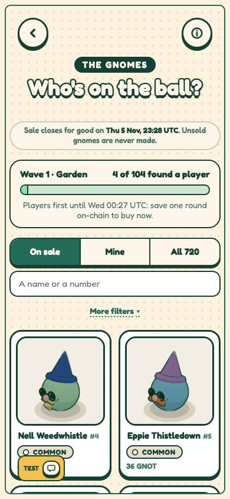
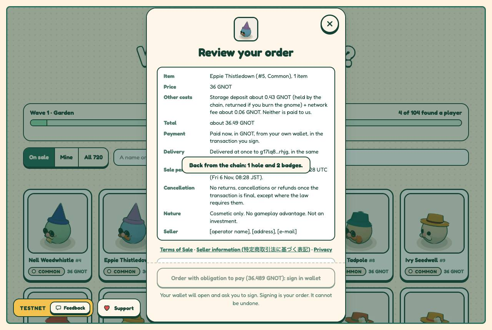
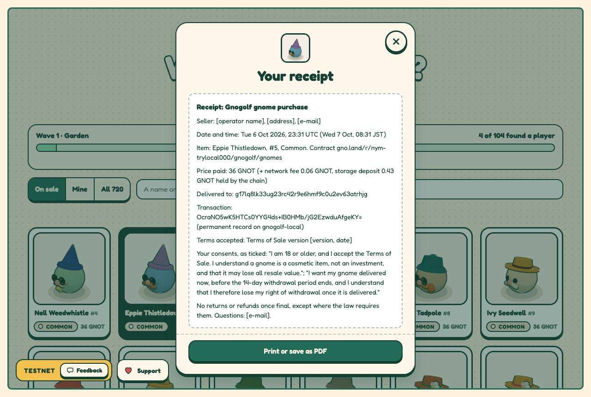
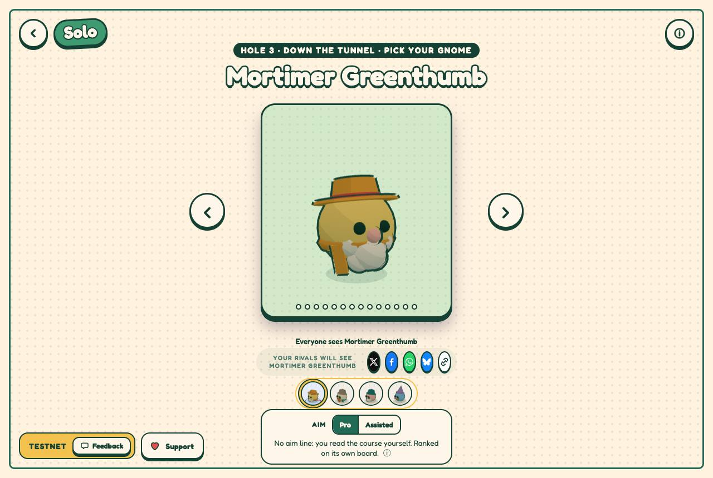
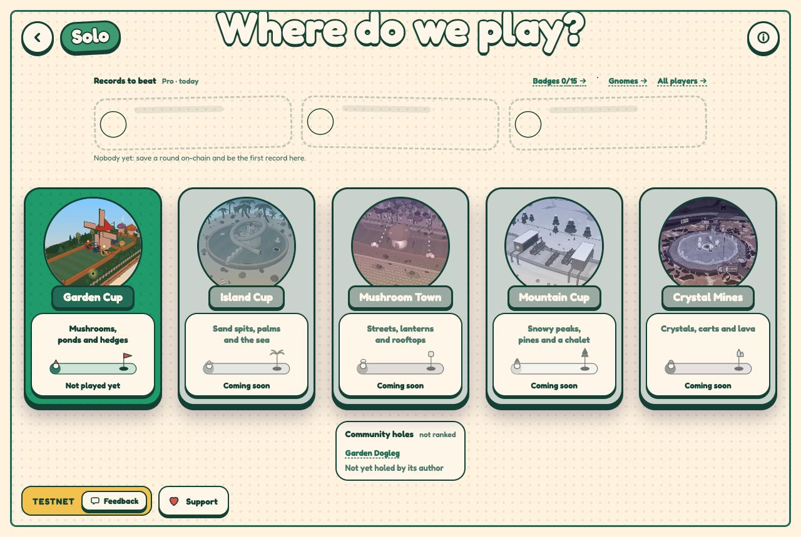
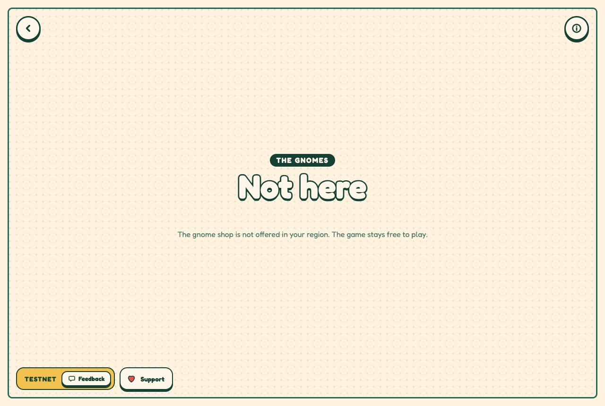

# The integration branch, tried end to end (2026-10-07)

`scripts/try-local.sh` started once on this machine (Tailscale
100.104.210.102, MagicDNS `mac-studio.tail8cf12f.ts.net`), then driven in
headless Chrome over the tailnet's HTTPS addresses, as a phone or another
computer would reach it. Local chain only (`gnogolf-local`); nothing sent
anywhere else.

## What ran

| run | result |
|-----|--------|
| `scripts/check.sh` (the Gno tests and goldens, holes, staging, portrait art, the aim preview's wasm with TinyGo 0.42.0, types, lint, selfcheck, the catalogue, 853 unit tests) | all passed |
| `try-local.sh`'s seed (deploy, Garden's 18 holes, genesis, wave 1, publishing, treasury) | 41 of 41 steps, 37 s |
| the site, `/g/`, `/build/`, the RPC and gnoweb from the Tailscale IP (http) and the MagicDNS name (https) | 200; the RPC answers CORS `*` |
| `media/gnomes/shop-e2e.mjs` over https (stand-in Adena signing with p1, b1, p0) | 89 pass, 2 fail (below) |
| `scripts/builderwalk.ts` over https, `SEED` p1: `/build`, a Bumper, Test it, each weather holed, Publish in Adena | published, 18 s |
| the cups screen: the walk's hole under Community holes, opened to play; `/g/?geo=blocked` | as expected |
| `scripts/e2e-builder.sh` (its own chain) | 208 pass, 0 fail, 11 noted |

The shop's two fails: "a later wave: Opens <date>" (the playground leaves
wave 2 to `try-local.sh wave2`, so no later wave is listed), and one page
error from Next's dev router (`reading 'isReady'`,
`next/dist/client/router.js`), at a different step each run, none in a
build. The Builder's 11 notes: 8 publishes storing 0 to 6% more than
`publishBytes` (within the deposit's tenth: every deposit cap held), and 3
holes the Builder refuses, published around it, still in the chain's list
(the game's lists judge them and hide them).

## Found and fixed on the way

- The Publish step read nothing under `next dev`: React's StrictMode
  double mount left its `live` flag false (`Publish.tsx`).
- The stand-in Adena named the seed's RPC, not the page's: `PAGE_RPC`.
- `e2e-builder.ts` was written against an older Publish API.

## A plain-http page on another device

Not a secure context: no `crypto.subtle` (the Builder's test mode and
publish, the community holes' check: every community hole would read "not
made with the Builder rules"), no `navigator.clipboard` nor
`navigator.share` (copying and sharing links), and the aim preview falls
back to the chain's. Playing, the shop, the receipt and wearing work. Hence
the HTTPS addresses `try-local.sh` serves on the tailnet.

## Screens

## Later the same day: the playground as the site is built

The https link "kept reloading" in the user's browser. Not reproduced here
(headless and headed Chrome, with and without an Adena, several tabs, pages
compiled mid-visit); once, `main-app.js` (7.6 MB in a dev build) failed to
load over the proxied https link. What was served was `next dev`: pages
compiled on demand, every build pushed to every open tab, its client
reloading the page when an update does not apply. The playground now serves
the site built as the real one is (`scripts/playground-server.mjs`: the
static build on 127.0.0.1, its `/rpc` streamed to the node), so none of that
is there. Verified through the ts.net name: no reload over a minute on the
title nor on a hole, all five cups playable (the course's 90 holes
published), the Builder from its card on "How do we play?" (the editor on a
computer, the play-only screen on a phone) and a hole published from it,
the gnomes from "Gnomes →" under the games and from the picker's line, the
region gate.
